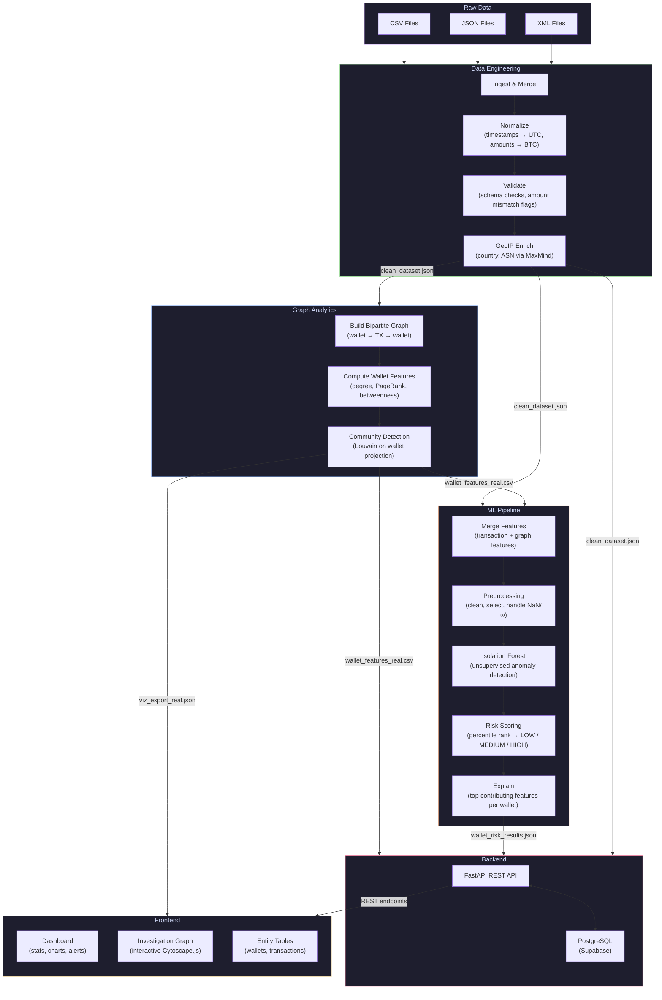
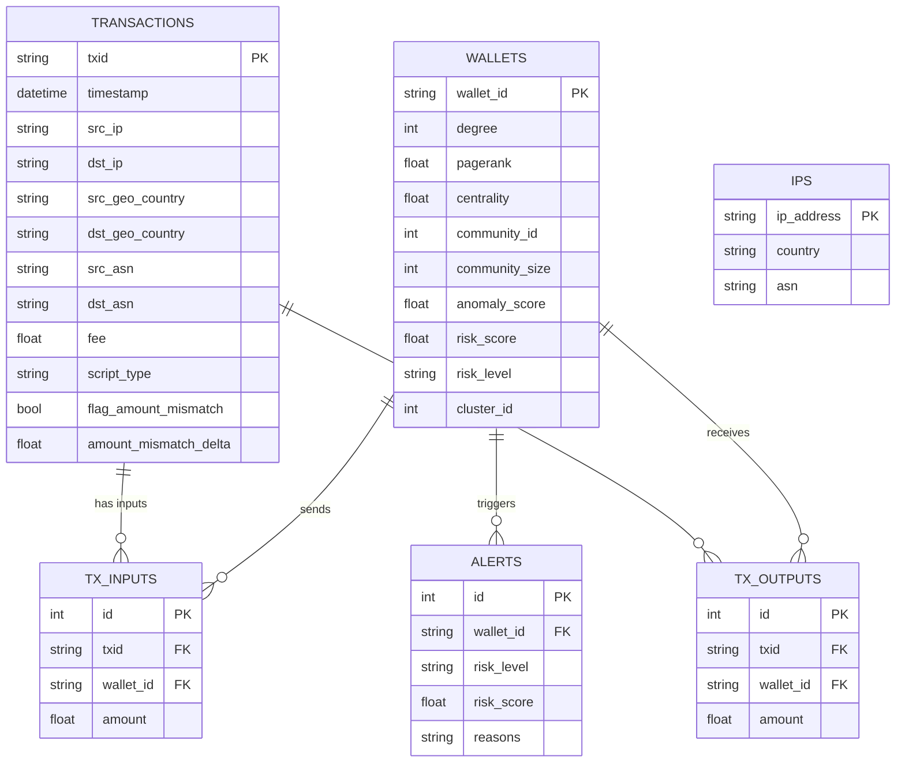

<div align="center">

# ₿ Bitcoin Forensic Investigation Platform

**Real-time Bitcoin transaction monitoring, graph analytics, anomaly detection & risk scoring**


</div>

---

## Table of Contents

- [Overview](#overview)
- [Architecture](#architecture)
- [Data Flow](#data-flow)
- [Modules](#modules)
- [API Endpoints](#api-endpoints)
- [Database Schema](#database-schema)
- [Quick Start](#quick-start)
- [Repository Structure](#repository-structure)
- [Assumptions & Known Limitations](#assumptions--known-limitations)

---

## Overview

An end-to-end platform for forensic analysis of Bitcoin transactions. Raw blockchain and network data flows through four processing stages — **data engineering**, **graph analytics**, **machine learning**, and a **REST API + dashboard** — to surface suspicious wallets, anomalous transaction patterns, and community clusters for investigators.

> **Key design principle:** This is **unsupervised anomaly detection**. There is no ground-truth fraud label — outputs are relative anomaly rankings, not confirmed fraud verdicts.

---

## Architecture



---

## Data Flow

| Step | Module | Input | Output | Description |
|------|--------|-------|--------|-------------|
| 1 | **Data Engineering** | Raw CSV / JSON / XML files in `data_engineering/raw/` | `clean_dataset.json` | Ingests multi-format files, normalizes timestamps to UTC, validates schema & flags amount mismatches, enriches with GeoIP (country + ASN) |
| 2 | **Graph Analytics** | `clean_dataset.json` | `wallet_features_real.csv` + `viz_export_real.json` | Builds a bipartite wallet↔TX graph, computes per-wallet features (degree, PageRank, betweenness centrality), runs community detection (Louvain), exports feature CSV for ML and node/edge JSON for visualization |
| 3 | **ML Pipeline** | `clean_dataset.json` + `wallet_features_real.csv` | `wallet_risk_results.csv` + `.json` | Computes wallet-level transaction features, merges with graph features, fits Isolation Forest, converts raw anomaly scores to percentile-ranked risk scores (0–100) with LOW/MEDIUM/HIGH levels, generates per-wallet explanations |
| 4 | **Backend** | All three outputs above (uploaded via API) | PostgreSQL database + REST API | Stores wallets, transactions, graph features, ML results, and auto-generated alerts; serves everything over REST |
| 5 | **Frontend** | Backend REST API | Interactive dashboard | Renders stats overview, risk gauges, transaction volume charts, ranked alerts, interactive investigation graph (Cytoscape.js), and entity tables |

---

## Modules

### `data_engineering/` — Data Ingestion & Cleaning

| | |
|---|---|
| **Purpose** | Load raw multi-format transaction data, normalize, validate, and enrich with geolocation |
| **Tech** | Python · Pandas · GeoIP2 (MaxMind) · xmltodict |
| **Entry point** | `python pipeline.py` |
| **Key files** | `ingest.py` → `normalize.py` → `validate.py` → `geoip.py` |
| **Output** | `output/clean_dataset.json` |

### `graph-analytics/` — Blockchain Graph Construction & Features

| | |
|---|---|
| **Purpose** | Build the entity/transaction graph and compute per-wallet graph features for ML and visualization |
| **Tech** | Python · NetworkX · community (Louvain) |
| **Entry point** | `python main.py [--input <path>] [--lenient]` |
| **Key files** | `ingest.py` → `graph_builder.py` → `features.py` → `export_features.py` / `export_viz.py` |
| **Output** | `data/real/wallet_features_real.csv` · `data/real/viz_export_real.json` |

> **Design note:** Transactions are modeled as their own nodes (wallet → TX → wallet bipartite graph), not flattened wallet-to-wallet edges. This correctly handles multi-input / multi-output Bitcoin transactions without ambiguity. A lossy wallet-to-wallet projection is available for simpler use cases.

### `ml/` — Anomaly Detection & Risk Scoring

| | |
|---|---|
| **Purpose** | Unsupervised anomaly detection — assigns risk scores and human-readable explanations to each wallet |
| **Tech** | Python · scikit-learn (Isolation Forest) · Pandas · NumPy |
| **Entry point** | `python -m ml.pipeline --transactions <path> --wallet-features <path> --output <path>` |
| **Key files** | `ingest.py` → `transaction_features.py` → `merge.py` → `preprocessing.py` → `model.py` → `risk_scoring.py` → `explain.py` |
| **Output** | `wallet_risk_results.csv` + `wallet_risk_results.json` |

### `backend/` — REST API & Database

| | |
|---|---|
| **Purpose** | Central API server — ingests all pipeline outputs, stores in PostgreSQL, serves queries for the frontend |
| **Tech** | FastAPI · SQLAlchemy · PostgreSQL (Supabase) · Uvicorn |
| **Entry point** | `uvicorn app.main:app --reload` |
| **Docs** | `http://127.0.0.1:8000/docs` (Swagger UI) |

### `frontend/` — Investigation Dashboard

| | |
|---|---|
| **Purpose** | Interactive dashboard for investigators — stats, alerts, graph exploration, entity tables |
| **Tech** | React 19 · Vite · Tailwind CSS · Cytoscape.js · Recharts · Lucide Icons |
| **Entry point** | `npm run dev` |
| **Key components** | `EntryScreen` · `InvestigationScreen` · `InvestigationGraph` · `EntityTable` · `AlertsCard` · `RiskGauge` · `VolumeChart` · `Heatmap` |

---

## API Endpoints

| Method | Endpoint | Description |
|--------|----------|-------------|
| `GET` | `/` | Health check |
| `GET` | `/wallet/{wallet_id}` | Get a single wallet's data |
| `GET` | `/transaction/{txid}` | Get a single transaction's data |
| `POST` | `/dataset/upload` | Upload cleaned transaction dataset (CSV/JSON/XML) |
| `POST` | `/graph-features/upload` | Upload wallet graph features CSV (degree, PageRank, community, etc.) |
| `POST` | `/ml/upload-results` | Upload ML risk-scoring results (CSV/JSON) |
| `GET` | `/graph/{entity}?hops=N` | Graph traversal centered on a wallet, up to N hops (default 2, max 5) |
| `GET` | `/alerts?risk_level=&limit=` | Ranked alerts, optional filter by `LOW` / `MEDIUM` / `HIGH` |
| `GET` | `/statistics` | Aggregate counts (wallets, transactions, alerts, risk breakdown) |
| `GET` | `/clusters` | Wallets grouped by `community_id` |

**Data loading order** (for a full dataset load):
1. `POST /graph-features/upload` — wallet features CSV
2. `POST /dataset/upload` — clean dataset JSON
3. `POST /ml/upload-results` — ML risk results

---

## Database Schema



---

## Quick Start

### Prerequisites

- Python 3.13+
- Node.js 18+
- PostgreSQL instance (or [Supabase](https://supabase.com/) free tier)
- MaxMind GeoLite2 databases (free signup at [maxmind.com](https://www.maxmind.com/en/geolite2/signup))

### 1. Clone & setup Python environment

```bash
git clone https://github.com/your-org/bitcoin-forensics.git
cd bitcoin-forensics
python -m venv .venv

# Windows
.venv\Scripts\activate

# macOS / Linux
source .venv/bin/activate

pip install -r requirements.txt
```

### 2. GeoIP databases

Download **GeoLite2-City.mmdb** and **GeoLite2-ASN.mmdb** from your MaxMind account and place them in:
- `data_engineering/geoip_data/` (for the data pipeline)
- `backend/data/` (for the backend)

### 3. Run the data pipeline

```bash
cd data_engineering
# Place your raw CSV/JSON/XML files in raw/
python pipeline.py
# → Outputs output/clean_dataset.json
```

### 4. Run graph analytics

```bash
cd graph-analytics
python main.py --input ../data_engineering/output/clean_dataset.json
# → Outputs data/real/wallet_features_real.csv
# → Outputs data/real/viz_export_real.json
```

### 5. Run the ML pipeline

```bash
python -m ml.pipeline \
  --transactions data_engineering/output/clean_dataset.json \
  --wallet-features graph-analytics/data/real/wallet_features_real.csv \
  --output ml/output/wallet_risk_results.csv
```

### 6. Start the backend

```bash
cd backend
pip install -r requirements.txt
# Set DATABASE_URL in .env pointing to your PostgreSQL instance
uvicorn app.main:app --reload
# → API at http://127.0.0.1:8000
# → Swagger docs at http://127.0.0.1:8000/docs
```

Upload data via the API (in order):
```bash
# 1. Graph features
curl -X POST http://127.0.0.1:8000/graph-features/upload -F "file=@wallet_features_real.csv"
# 2. Clean dataset
curl -X POST http://127.0.0.1:8000/dataset/upload -F "file=@clean_dataset.json"
# 3. ML results
curl -X POST http://127.0.0.1:8000/ml/upload-results -F "file=@wallet_risk_results.json"
```

### 7. Start the frontend

```bash
cd frontend
npm install
npm run dev
# → Dashboard at http://localhost:5173
```

---

## Repository Structure

```
bitcoin-forensics/
├── data_engineering/           # Stage 1: Data ingestion & cleaning
│   ├── raw/                    #   Raw input files (CSV/JSON/XML)
│   ├── output/                 #   Generated clean_dataset.json (gitignored)
│   ├── geoip_data/             #   MaxMind .mmdb files (gitignored)
│   ├── pipeline.py             #   Pipeline entry point
│   ├── ingest.py               #   Multi-format file loader
│   ├── normalize.py            #   Timestamp & amount normalization
│   ├── validate.py             #   Schema validation & mismatch flags
│   ├── geoip.py                #   GeoIP enrichment (country + ASN)
│   └── generate_sample_data.py #   Test data generator
│
├── graph-analytics/            # Stage 2: Graph construction & features
│   ├── data/                   #   Input/output data (gitignored)
│   ├── src/
│   │   ├── ingest.py           #   Transaction loader
│   │   ├── graph_builder.py    #   Bipartite graph construction
│   │   ├── features.py         #   Wallet feature computation
│   │   ├── traversal.py        #   N-hop neighborhood queries
│   │   ├── export_features.py  #   Wallet feature CSV export
│   │   └── export_viz.py       #   Visualization JSON export
│   ├── tests/                  #   Unit tests
│   └── main.py                 #   Pipeline entry point
│
├── ml/                         # Stage 3: Anomaly detection & risk scoring
│   ├── ingest.py               #   Data loaders
│   ├── transaction_features.py #   Wallet-level transaction features
│   ├── merge.py                #   Feature merge with validation
│   ├── preprocessing.py        #   Feature selection & cleaning
│   ├── model.py                #   Isolation Forest wrapper
│   ├── risk_scoring.py         #   Anomaly → risk score → risk level
│   ├── explain.py              #   Per-wallet explanation generator
│   ├── pipeline.py             #   End-to-end orchestrator
│   └── tests/                  #   Unit tests
│
├── backend/                    # Stage 4a: REST API & database
│   ├── app/
│   │   ├── main.py             #   FastAPI app with CORS
│   │   ├── models.py           #   SQLAlchemy ORM models
│   │   ├── schemas.py          #   Pydantic request/response schemas
│   │   ├── database.py         #   DB engine & session
│   │   ├── config.py           #   Environment config
│   │   ├── routers/            #   Route handlers (wallet, graph, alerts, etc.)
│   │   ├── services/           #   Business logic layer
│   │   └── utils/              #   Shared utilities
│   └── tests/                  #   API tests
│
├── frontend/                   # Stage 4b: Investigation dashboard
│   ├── src/
│   │   ├── App.jsx             #   Root application
│   │   ├── components/         #   UI components
│   │   │   ├── EntryScreen.jsx         #   Landing / upload screen
│   │   │   ├── InvestigationScreen.jsx #   Main investigation view
│   │   │   ├── InvestigationGraph.jsx  #   Interactive Cytoscape graph
│   │   │   ├── EntityTable.jsx         #   Wallet/transaction tables
│   │   │   ├── AlertsCard.jsx          #   Risk alert list
│   │   │   ├── RiskGauge.jsx           #   Risk score gauge
│   │   │   ├── VolumeChart.jsx         #   Transaction volume chart
│   │   │   ├── Heatmap.jsx             #   Activity heatmap
│   │   │   └── ...
│   │   ├── services/           #   API client layer
│   │   └── data/               #   Static/mock data
│   └── package.json
│
├── requirements.txt            # Root Python dependencies
└── .gitignore
```

---

## Assumptions & Known Limitations

| Area | Assumption | Impact |
|------|-----------|--------|
| **Timestamps** | All timestamps are assumed UTC if no timezone info is present in source data | If the real dataset uses local time or mixed timezones, the normalization will be incorrect and needs revisiting before graph/ML layers can trust timing correlation |
| **Fee / Script Type** | Pipeline supports both fields but defaults to `null` if absent from source | Not yet confirmed whether the real dataset includes them |
| **GeoIP Coverage** | Some src/dst IPs may return `null` country/ASN | Expected for private/reserved ranges (10.x, 127.x, 100.64.0.0/10). City and ASN lookups are independent — partial results are preserved. Real organizer-provided IPs should resolve at a higher rate |
| **Risk Score** | `risk_score` is a **percentile rank** (0–100) relative to the current wallet population | It is **not** a calibrated fraud probability |
| **Graph Edges** | Edges in `/graph/{entity}` are derived **live** from `tx_inputs`/`tx_outputs` joins | There is no precomputed edge table |
| **Anomaly Detection** | Isolation Forest is unsupervised — no ground-truth labels exist | Nothing produced should be described as "confirmed fraud" |

---

<div align="center">

**Built for SIH 2026**

</div>